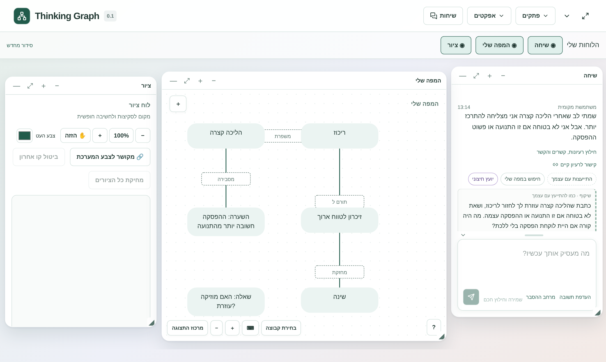
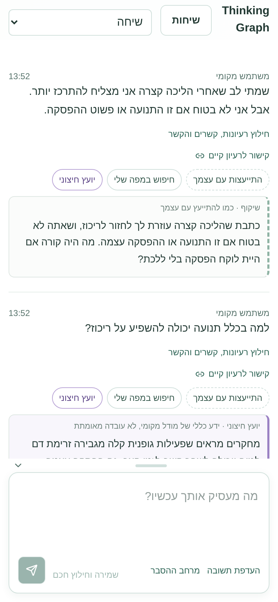
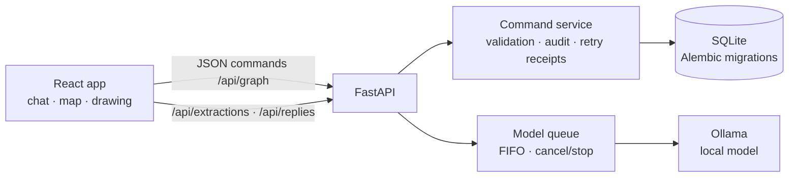

# Thinking Graph

[](https://github.com/topazsarid/Thinking-Graph/actions/workflows/ci.yml)

**A local-first thinking workspace: write your thoughts in a chat, turn them into a visual map of ideas and relationships, and consult a local AI — without your private thoughts ever leaving your computer.**



<sub>Demo data. The interface is in Hebrew (right-to-left); English is on the roadmap.</sub>

## Why

Most AI tools blur the line between *what you think* and *what the AI suggested*. Thinking Graph keeps them apart:

- **My Map** is yours. Nothing enters it without your explicit approval.
- **AI output is always labeled** and kept separate (reviewed extraction drafts, reply cards, a separate Explanation screen).
- **Every idea keeps its source**: which message it came from, who created it, and its full edit history.
- **Private by default**: all AI runs on a local model through [Ollama](https://ollama.com); no cloud AI calls.

## Features

**Chat → map**
- Write freely; *smart extraction* asks the local model for ideas, relationships and context, with quotes that must appear verbatim in your text. You review, edit and approve before anything reaches the map, and the map then centers on the new ideas.
- Ideas can live in several workspaces at once; relationships can have multiple participants and typed labels (a hierarchy of relation types).

**Three ways to get a reply** — under every message, only when you ask:
- *Consult yourself*: mirrors your own words back with one question; no outside knowledge.
- *Search my map*: instant text search across all workspaces (with a jump to another workspace), then an optional AI search for *similar* ideas.
- *External advisor*: a general-knowledge answer, clearly marked as unverified, plus a key concept on a separate Explanation screen.

**A local-model queue** — all AI requests wait in one visible line; you can cancel a waiting request or stop a running one (the stream is closed so the model stops). The rest of the app stays usable while the model works.

**Workspace** — draggable, resizable windows (chat, map, drawing board), a focus mode, drawing zoom/pan, notes and tasks, conversation history, per-conversation answer preferences, and a phone layout.

<p align="center"></p>

**Personal touches** — optional background effects (birds, a growing garden, a burning screen), a theme color picker, and an effect studio: paint your own pixel pattern on a grid, or upload images that float behind the windows. Effects are stored only in the browser.

## Tech stack

| Layer | Technology |
|---|---|
| Frontend | React 19, TypeScript, Vite, Tailwind CSS 4, Radix UI, SVG map rendering |
| Backend | Python 3.12, FastAPI, Pydantic, SQLAlchemy 2, Alembic migrations |
| Data | SQLite (transactional commands with audit events and idempotent retries) |
| AI | Ollama (default `qwen3.5:4b`), structured JSON output validated with Pydantic, streaming with cancellation |
| Ops | Docker (multi-stage image), Docker Compose with a persistent volume |
| Tests | pytest (API, migrations, queue), Node test runner (client logic), Playwright end-to-end tests with a fake model |

## Architecture



- Every change is a validated command executed in one database transaction, together with its audit event. A command ID makes retries safe (no duplicates after a lost response).
- Model output is treated as **untrusted**: it must match a JSON schema, quotes must exist in the source text, and nothing is written to the map without review.
- More detail: [docs/ARCHITECTURE.md](docs/ARCHITECTURE.md) · product principles: [docs/PRODUCT.md](docs/PRODUCT.md).

## Getting started

### With Docker

```bash
docker compose up --build
```

Open http://localhost:8000. Data is kept in the `thinking-graph-data` volume. AI features need Ollama reachable from the container: set `THINKING_GRAPH_OLLAMA_URL` (for example `http://host.docker.internal:11434`).

### Local development (Windows shown; use `.venv/bin/python` on macOS/Linux)

Requires Python 3.12 and Node 22+.

```bat
python -m venv .venv
.venv\Scripts\python.exe -m pip install -r requirements.txt
npm ci
npm run build
.venv\Scripts\python.exe -m backend
```

Open http://127.0.0.1:8000. For live UI reloading run `npm run dev` (port 5173) next to the backend.

### Local AI (optional)

Install [Ollama](https://ollama.com), then `ollama pull qwen3.5:4b`. Another local model can be chosen with `THINKING_GRAPH_MODEL`. Without Ollama everything except the AI features works.

## Tests

```bat
.venv\Scripts\python.exe -m pytest -q                      :: API, migrations, queue, replies
node --test --experimental-test-isolation=none tests/map_search.test.ts
.venv\Scripts\python.exe -m pip install -r requirements-e2e.txt
.venv\Scripts\python.exe -m playwright install chromium
.venv\Scripts\python.exe -m pytest tests/e2e -q             :: browser tests (after npm run build)
```

The end-to-end tests start their own server with a throwaway database and a fake, slow, streaming model, so they never touch real data. GitHub Actions runs the build and all tests on every push ([.github/workflows/ci.yml](.github/workflows/ci.yml)).

## Roadmap

Planned next (see [docs/MVP-PLAN.md](docs/MVP-PLAN.md)): an interactive AI **Explanation Map** that grows during a conversation, copying content between boards, a Hebrew/English interface, and private cloud access from a phone.

## Documentation

- [docs/README.he.md](docs/README.he.md) — original Hebrew README with the full development log
- [docs/ARCHITECTURE.md](docs/ARCHITECTURE.md), [docs/PRODUCT.md](docs/PRODUCT.md), [docs/MVP-PLAN.md](docs/MVP-PLAN.md)
- [AGENTS.md](AGENTS.md) — how AI coding agents work in this repository (shared rules, handoff notes)

## License

[MIT](LICENSE)
